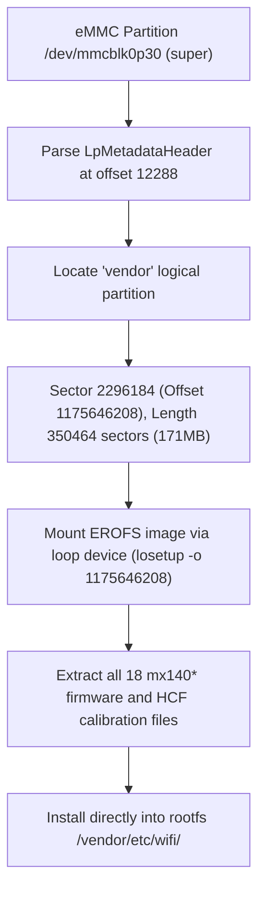

# S5N2560 Wi-Fi Bringup & Configuration Guide

> [!NOTE]
> **Chipset:** Samsung System LSI / SCSC (Samsung Cambridge Solution Centre) **S5N2560**  
> **Bus:** Platform device `119c0000.scsc_wifibt`  
> **Kernel Driver:** Built-in `scsc_wlan` (`slsi_wlan`)  
> **Interface:** `wlan0` (Dual-Band 2.4 GHz & 5 GHz 802.11ac)  

---

## 1. Problem Statement

On fresh postmarketOS installations on the Samsung Galaxy A21s:
1. `wlan0` starts in a `DOWN` state with MAC address `00:00:00:00:00:00`.
2. Running `ip link set wlan0 up` fails with:
   ```text
   RTNETLINK answers: Invalid argument
   ```
   Kernel dmesg reveals:
   ```text
   [wlbt] __mx140_file_download_fw: Load WLBT fw /vendor/etc/wifi/mx140.bin
   [wlbt] __mx140_request_file: vfs_stat() failed for /vendor/etc/wifi
   [wlbt] __mx140_file_download_fw: Error Loading FW, error -11
   [wlbt] fw_init: mx140_file_download_fw() failed (-11)
   ```
3. The upstream `firmware-samsung-a21s` package only provides touch screen firmware (`td4150_a21s.bin`), completely omitting Wi-Fi firmware.
4. The Samsung kernel driver bypasses Linux's standard `request_firmware()` mechanism (`/lib/firmware`) and uses direct kernel VFS calls to read `/vendor/etc/wifi/mx140.bin`.
5. NetworkManager attempts MAC address randomization during Wi-Fi scans by default (`set MAC address to XX:XX:XX:XX:XX:XX (scanning)`). The Samsung SCSC driver rejects runtime MAC changes with `Invalid argument`, causing `wpa_supplicant couldn't grab this interface` errors.

---

## 2. Extraction from Stock Android `super` Partition

The Samsung Galaxy A21s stores the stock vendor files inside the Android dynamic partitions on `/dev/mmcblk0p30` (`super`).



### Firmware Files Installed:
- `mx140.bin` (1.6 MB core firmware binary)
- `mx140_t.bin` (1.1 MB firmware variant)
- `mx140_bt.hcf` (Bluetooth hardware configuration)
- `mx140_wlan.hcf`, `mx140_wlan_sw.hcf`, `mx140_wlan_t.hcf` (Wi-Fi calibration tables)
- `slsi_reg_database.bin` (Worldwide regulatory domain rules)
- `hydra_config.sdb` (Radio coexistence database)

All files are backed up locally in the repository under:
`device-samsung-a21s/wifi/`

---

## 3. Disabling Scanning MAC Randomization

In `/etc/NetworkManager/conf.d/99-wifi.conf`:
```ini
[device-wlan]
match-device=interface-name:wlan*
managed=1

[device]
wifi.scan-rand-mac-address=no

[connection]
wifi.cloned-mac-address=preserve
```

This ensures NetworkManager:
1. Retains the real hardware MAC address (`00:00:0F:XX:XX:XX`) provided by the firmware.
2. Prevents `wpa_supplicant` failure loops.
3. Automatically marks `wlan0` as managed.

---

## 4. Boot Automation Service (`wlan0-init.service`)

Because the SCSC chip requires an explicit `ip link set wlan0 up` to power on its radio and trigger udev device notification, `wlan0-init.service` runs after NetworkManager starts:

```ini
[Unit]
Description=Bring up wlan0 interface and integrate with NetworkManager
After=NetworkManager.service
Wants=NetworkManager.service

[Service]
Type=oneshot
ExecStartPre=/bin/sleep 2
ExecStart=/bin/sh -c "/sbin/ip link set wlan0 up && /usr/bin/udevadm trigger --action=add /sys/class/net/wlan0 && /usr/bin/udevadm settle && /usr/bin/nmcli device set wlan0 managed yes"
RemainAfterExit=yes

[Install]
WantedBy=multi-user.target
```

---

## 5. Connecting to Wi-Fi

To scan available networks:
```bash
nmcli device wifi list
```

To connect to your Wi-Fi network:
```bash
nmcli device wifi connect "YOUR_SSID" password "YOUR_PASSWORD"
```

To check connection details:
```bash
nmcli connection show
ip addr show wlan0
```
